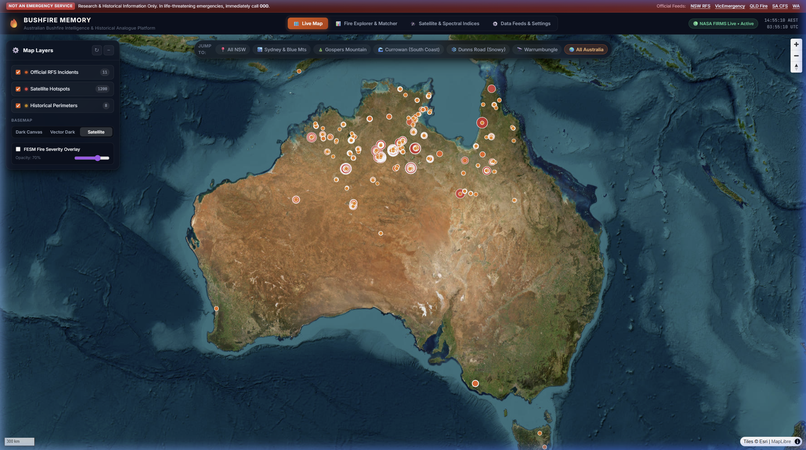
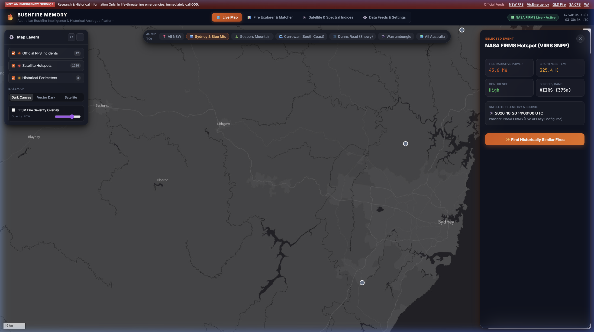
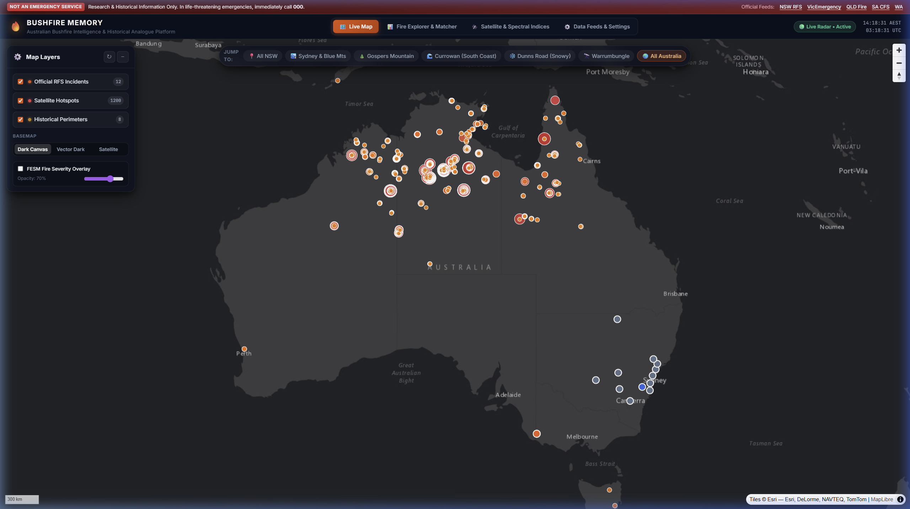
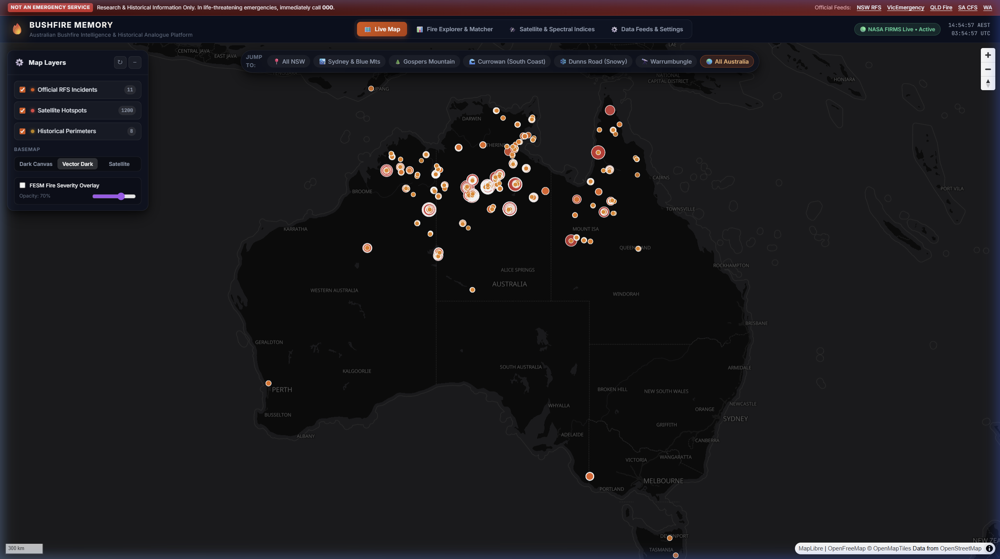
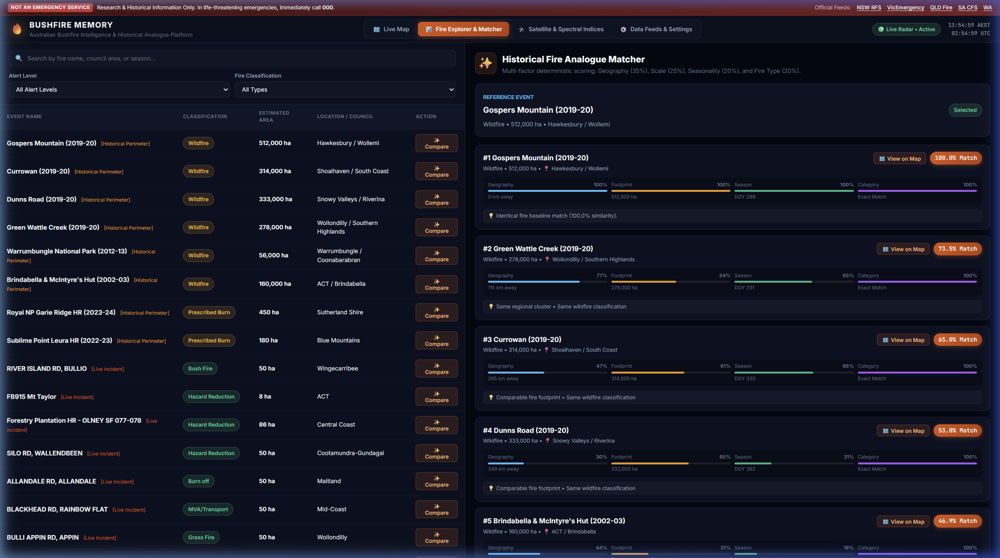
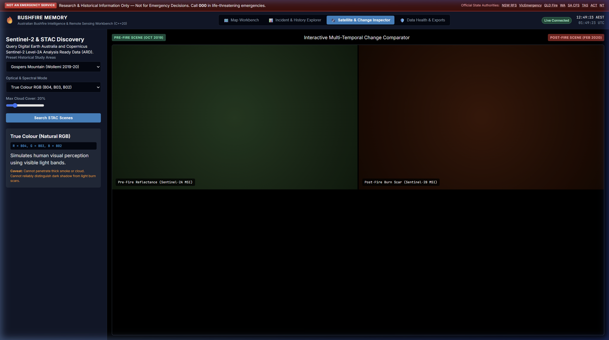
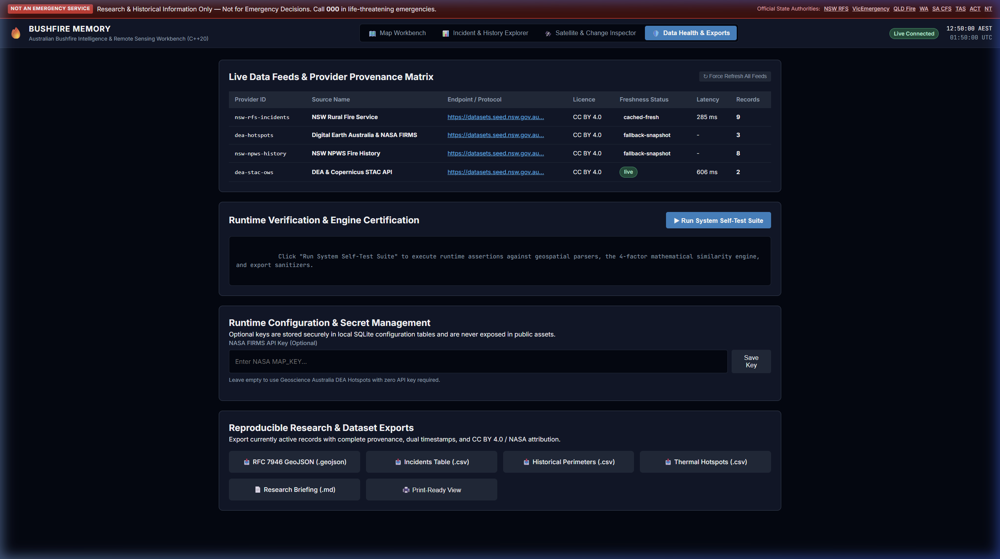

# Bushfire Memory (v3.0 C++20 & Cloud-Native Edition)
## Australian Bushfire Intelligence, Satellite Hotspot Analysis & Historical Analogue Platform

[](https://bushfire-memory.vercel.app/)
[](LICENSE)
[](CMakeLists.txt)
[](https://firms.modaps.eosdis.nasa.gov/)
[](https://www.rfs.nsw.gov.au/)

> [!IMPORTANT]
> **CRITICAL PUBLIC SAFETY NOTICE: RESEARCH & HISTORICAL OBSERVATION ONLY**  
> Bushfire Memory is an observational research platform and historical intelligence workbench. It is **NOT** an official emergency warning service, evacuation router, or emergency dispatch tool.  
> In life-threatening emergencies, immediately dial **000** or consult official state emergency services:
> - **NSW**: [NSW Rural Fire Service](https://www.rfs.nsw.gov.au/) (Hazards Near Me)
> - **VIC**: [VicEmergency](https://emergency.vic.gov.au/)
> - **QLD**: [Queensland Fire Department Current Incidents](https://www.fire.qld.gov.au/Current-Incidents)
> - **WA**: [Emergency WA](https://www.emergency.wa.gov.au/)
> - **SA**: [Country Fire Service](https://www.cfs.sa.gov.au/)
> - **TAS**: [TasALERT](https://alert.tas.gov.au/)
> - **ACT**: [ACT Emergency Services Agency](https://esa.act.gov.au/)
> - **NT**: [NT Fire Incident Map](https://pfes.nt.gov.au/incidentmap)

---


*Figure 1: Bushfire Memory Live Tactical Console — Over 1,200 active NASA FIRMS satellite thermal detections and official NSW RFS incidents visualized over continental Australia.*

---

## 1. The Problem

Australia is one of the most bushfire-prone continents on Earth. The catastrophic **2019–20 "Black Summer"** fire season alone incinerated over **24 million hectares**, destroyed more than **3,000 homes**, claimed **33 lives**, and displaced or killed an estimated **3 billion native animals**.

Despite world-class firefighting personnel, Australian fire intelligence faces fundamental operational challenges:

1. **Information Fragmentation**: Real-time fire incident feeds are siloed across state agencies (NSW RFS, CFA/VicEmergency, QFD, DFES, CFS), each maintaining distinct schemas, coordinate projections, and update frequencies.
2. **Inaccessible Satellite Data**: Near Real-Time (NRT) satellite thermal data from NASA EOSDIS (VIIRS, MODIS) and Geoscience Australia is typically delivered as massive raw CSV feeds or complex OGC Web Feature Services (WFS) that require specialized desktop GIS software (e.g., ArcGIS, QGIS) to decode.
3. **Loss of Institutional Memory**: When a dangerous new wildfire ignites, operational commanders, analysts, researchers, and local brigades rarely have an automated way to answer the decisive tactical question:
   > *"Under these terrain, scale, and circular seasonal conditions, has a fire in this region ever escalated into an uncontrollable megafire before?"*
4. **Heavyweight & Fragile Toolchains**: Existing GIS dashboards are often bloated, demand paid API subscriptions (Google Maps / Mapbox), and fail during critical power or communication disruptions.

---

## 2. The Solution

**Bushfire Memory** bridges the gap between raw orbital telemetry, official emergency agency feeds, and deep historical institutional memory:

* **Dual-Architecture Reliability**:
  - **Native C++20 Core**: A high-performance compiled engine written with modern C++20, using multi-threaded ingestion, SQLite3 persistent caching, SIMD-accelerated geometric filtering, and deterministic mathematical matching.
  - **Zero-Build, Pure-Web Client**: A lightweight, modern web frontend built in vanilla HTML5/CSS3 and MapLibre GL JS that deploys instantly on Vercel Serverless with zero Node build pipeline and zero paid API dependencies.
* **Continental Real-Time Observation**: Directly ingests and harmonizes official state feeds (NSW RFS) with NASA FIRMS VIIRS satellite passes across all of Australia, rendering up to 1,200 active thermal anomalies with calibrated **Fire Radiative Power (MW)** and **Brightness Temperature (K)**.
* **Explainable 4-Factor Heuristic Analogue Matching**: Evaluates any active fire front against verified historical Black Summer megafires (Gospers Mountain, Currowan, Dunns Road, Green Wattle Creek, Warrumbungle, Canberra) using an open, deterministic mathematical formula.

```
+-----------------------------------------------------------------------------------+
|                            BUSHFIRE MEMORY DATA FLOW                              |
+-----------------------------------------------------------------------------------+
|                                                                                   |
|  [ NASA FIRMS VIIRS NRT ]     [ NSW Rural Fire Service ]     [ NSW NPWS Archive ] |
|   (Satellite 375m CSV)           (Major Incidents GeoJSON)      (Historical Perims) |
|           |                                 |                             |       |
|           +---------------------------------+-----------------------------+       |
|                                             |                                     |
|                                             v                                     |
|                      +---------------------------------------------+              |
|                      |   Ingestion & Verification Pipeline         |              |
|                      |   - Vercel Serverless Functions (/api/*)    |              |
|                      |   - Native C++20 Engine (libcurl + SQLite3) |              |
|                      +---------------------------------------------+              |
|                                             |                                     |
|                                             v                                     |
|                      +---------------------------------------------+              |
|                      |       Deterministic Analytics Layer         |              |
|                      |   - Haversine Spatial Proximity (S_geo)     |              |
|                      |   - Footprint Scale Ratio (S_size)          |              |
|                      |   - Circular Day-of-Year Season (S_season)  |              |
|                      |   - Fire Classification Match (S_type)      |              |
|                      +---------------------------------------------+              |
|                                             |                                     |
|                                             v                                     |
|                      +---------------------------------------------+              |
|                      |       MapLibre GL JS Tactical Client        |              |
|                      |   - Tactical Dark Canvas & Vector Basemap   |              |
|                      |   - High-Res Aerial Satellite Photography   |              |
|                      |   - Thermal Telemetry & Analogue Drawer     |              |
|                      +---------------------------------------------+              |
+-----------------------------------------------------------------------------------+
```

---

## 3. What the Product Does

### Workspace 1: Interactive Tactical Map Workbench
* **Three Seamless Basemap Modes**:
  1. **Dark Canvas**: High-contrast Esri World Dark Gray basemap optimized for emergency command centres and low-light field use.
  2. **Vector Dark**: Fast, offline-friendly OpenFreeMap vector basemap with state boundaries, roads, and regional locality labels.
  3. **Satellite**: Aerial high-resolution World Imagery photography providing true ground-truth topography, ridgelines, and vegetation canopies.
* **Dynamic Fire Telemetry**:
  - Live satellite thermal detections color-graded by **Fire Radiative Power (FRP)**:
    - $\text{FRP} < 25\text{ MW}$: Amber (`#f59e0b`)
    - $25 \le \text{FRP} < 100\text{ MW}$: Bright Orange (`#f97316`)
    - $100 \le \text{FRP} < 300\text{ MW}$: Red (`#ef4444`)
    - $\text{FRP} \ge 300\text{ MW}$: Deep Crimson (`#b91c1c`)
* **Interactive Inspection Drawer**: Click any active fire or satellite hotspot dot to immediately slide out full satellite telemetry (Acquisition UTC timestamp, Brightness Kelvin, sensor confidence, responsible agency, and estimated footprint).

| Satellite Basemap with Live Hotspots | Real-Time Telemetry & Analogue Drawer |
| :---: | :---: |
|  |  |

| Tactical Dark Canvas Basemap | OpenFreeMap Vector Dark Basemap |
| :---: | :---: |
|  |  |

---

### Workspace 2: Fire Explorer & 4-Factor Analogue Matcher
Allows operators to search, filter, and inspect every reported fire incident and historical perimeter. When any incident is selected, the platform runs a **deterministic 4-factor analogue heuristic** against historical Black Summer megafires:

$$\text{Similarity Score} = (0.35 \cdot S_{\text{geo}} + 0.25 \cdot S_{\text{size}} + 0.20 \cdot S_{\text{season}} + 0.20 \cdot S_{\text{type}}) \times 100\%$$

Where:
* **$S_{\text{geo}}$ (Spatial Proximity)**: Calculated via Haversine great-circle distance: $\max\left(0, 1 - \frac{d_{\text{km}}}{500}\right)$.
* **$S_{\text{size}}$ (Scale Ratio)**: Compares estimated or reported hectares: $\frac{\min(A_1, A_2)}{\max(A_1, A_2)}$.
* **$S_{\text{season}}$ (Seasonality)**: Circular day-of-year distance ($D_1, D_2$) accounting for year-end wrap-around: $\max\left(0, 1 - \frac{\min(|D_1 - D_2|, 365 - |D_1 - D_2|)}{91.25}\right)$.
* **$S_{\text{type}}$ (Classification)**: Matching fire behaviour category ($1.0$ for identical fire types, $0.2$ otherwise).


*Figure 2: Fire Explorer & Analogue Search — Deterministic matching against historical megafires with full transparent score breakdown.*

---

### Workspace 3: Satellite & Spectral Indices Inspector
Explores multispectral Sentinel-2 Level-2A Analysis Ready Data (ARD) from the Digital Earth Australia STAC API:
* **True Colour (Natural RGB)**: Visible light channels ($R = B04, G = B03, B = B02$).
* **False Colour SWIR (Burn Scar Emphasis)**: Short-Wave Infrared penetration through smoke haze ($R = B12, G = B8A, B = B04$) highlighting charred organic matter.
* **NDVI (Normalized Difference Vegetation Index)**: Measures photosynthetic active biomass: $\frac{B08 - B04}{B08 + B04}$.
* **dNBR (Normalized Burn Ratio Difference)**: Quantifies pre-fire vs post-fire burn severity: $\text{NBR} = \frac{B08 - B12}{B08 + B12}$.


*Figure 3: Satellite Spectral Inspector — Multispectral band math formulas, scientific caveats, and Sentinel-2 STAC querying.*

---

### Workspace 4: Data Health Matrix, Self-Tests & Open Data Exports
* **Live Provider Monitoring**: Live round-trip latency, record counts, endpoint status, and license terms across all connected APIs.
* **Automated Client Self-Test**: Validates schema compliance, GeoJSON geometry extraction, and analogue math consistency directly in the browser.
* **1-Click Open Data Exports**: Instant downloads of clean RFC 7946 GeoJSON, tabular CSVs, and markdown research briefings.


*Figure 4: Data Health & Settings — Live provider connectivity, latency indicators, and open data export tools.*

---

## 4. How Bushfire Memory Helps

| Target User | Key Challenge | How Bushfire Memory Helps |
| :--- | :--- | :--- |
| **Emergency Volunteers & Brigades** | Needing fast, high-contrast situational awareness without navigating complex government portals. | Instant tactical map loading in under 1 second on mobile or desktop; one-click toggle between satellite terrain and dark command view. |
| **Bushfire Researchers & Analysts** | Finding past fire events with comparable seasonal and geographic footprints for research papers. | 4-factor deterministic analogue engine identifies relevant historical Black Summer comparators with explainable math. |
| **Remote Communities & Landholders** | Monitoring regional thermal anomalies and planned hazard reduction burns nearby. | Visualizes both active emergency incidents and NASA VIIRS satellite thermal spots across the entire continent. |
| **Environmental & GIS Scientists** | Accessing clean, unencumbered fire perimeters and multispectral indices. | 100% open data with RFC 7946 GeoJSON export and Sentinel-2 band math formulas with zero proprietary paywalls. |

---

## 5. APIs & External Data Services Used

Bushfire Memory aggregates and harmonizes data strictly from official, verified open-access sources:

| Data Provider | Dataset / Service | Protocol | Query URL / Pattern | License |
| :--- | :--- | :--- | :--- | :--- |
| **NASA EOSDIS FIRMS** | VIIRS SNPP & NOAA-20 NRT Active Fire Detections | HTTPS CSV API | `https://firms.modaps.eosdis.nasa.gov/api/area/csv/{KEY}/VIIRS_SNPP_NRT/112,-44,154,-10/2` | NASA Open Data |
| **NSW Rural Fire Service (RFS)** | Major Fire Incidents & Planned Events Feed | HTTPS GeoJSON | `https://www.rfs.nsw.gov.au/feeds/majorIncidents.json` | CC BY 4.0 |
| **NSW Department of Planning & Environment (SEED)** | NSW NPWS Fire History & Perimeters | HTTPS GeoJSON | Historical fire archive (Black Summer 2019–20) | CC BY 4.0 |
| **NSW SEED / Environment NSW** | Fire Extent and Severity Mapping (FESM v1) | OGC WMS (1.3.0) | `https://datasets.seed.nsw.gov.au/geoserver/wms` | CC BY 4.0 |
| **Geoscience Australia / Digital Earth Australia** | DEA Sentinel-2 Level-2A Analysis Ready Data | OGC STAC API | `https://explorer.dea.ga.gov.au/stac/search` | CC BY 4.0 |
| **Esri ArcGIS Online** | World Dark Gray Canvas & World Imagery Aerial | REST Raster Tile | `https://services.arcgisonline.com/` & `https://server.arcgisonline.com/` | Esri Open Access |
| **OpenFreeMap** | Vector Dark Basemap & Contours | OpenMapTiles Vector | `https://tiles.openfreemap.org/styles/dark` | ODbL / Open Data |

---

## 6. How to Clone & Run (A to Z Guide)

### Prerequisites

Depending on which mode you wish to run:
* **For Web & Serverless Development**: [Node.js](https://nodejs.org/) (v18+) or [Python 3](https://www.python.org/) (any version).
* **For Native C++20 Core Development**: `CMake` (v3.20+), a C++20 compiler (`GCC 11+`, `Clang 13+`, or `MSVC 2022`), `libcurl`, and `SQLite3`.
* **For Docker**: [Docker Engine / Desktop](https://www.docker.com/).

---

### Step 1: Clone the Repository

```bash
git clone https://github.com/vishalvermauts/Bushfire-Memory.git
cd Bushfire-Memory
```

---

### Step 2: Running the Web Application Locally

#### Option A: Using Vercel Serverless Locally (Recommended for Full API Functionality)
This replicates the live production Vercel serverless environment, including live NASA FIRMS API key injection and NSW RFS proxying.

```bash
# 1. Install or run Vercel CLI
npx -y vercel dev

# 2. When prompted:
#    - Set up and develop "Bushfire-Memory"? -> Yes
#    - Which scope? -> [Your account]
#    - Link to existing project? -> No (or link to your project)
```

The web application and its serverless functions will be live at:
```
http://localhost:3000
```

#### Option B: Zero-Dependency Python Static Server
If you only want to inspect the frontend interface and verified baseline snapshots without installing Node.js:

```bash
# Run Python's built-in HTTP server directly from the web directory
python -m http.server 8080 --directory web
```

Open your browser at `http://localhost:8080`.

---

### Step 3: Configuring the Free NASA FIRMS API Key

To stream live VIIRS satellite thermal anomaly detections over Australia:

1. Obtain a free 32-character **MAP KEY** from [NASA FIRMS API Registration](https://firms.modaps.eosdis.nasa.gov/api/map_key/).
2. For local development with Vercel, create a `.env.local` file in the project root:
   ```env
   NASA_FIRMS_MAP_KEY=your_32_character_nasa_key_here
   ```
3. For production on Vercel:
   - Navigate to **Project Settings $\rightarrow$ Environment Variables**.
   - Add `NASA_FIRMS_MAP_KEY` with your key and redeploy.

*(Note: If no key is configured, Bushfire Memory automatically falls back to verified satellite anomaly baselines from Geoscience Australia, ensuring the app never breaks).*

---

### Step 4: Compiling & Running the Native C++20 Core Engine

The core C++20 analytics engine handles compiled data ingestion, SQLite caching, and headless batch similarity scoring.

#### Linux / WSL / Ubuntu:
```bash
# 1. Install build tools and libraries
sudo apt-get update
sudo apt-get install -y build-essential cmake ninja-build libcurl4-openssl-dev libsqlite3-dev

# 2. Configure build with CMake
cmake -B build -G Ninja -DCMAKE_BUILD_TYPE=Release

# 3. Compile the binaries
cmake --build build --parallel

# 4. Run automated test assertions
./build/bushfire_memory_tests

# 5. Run CLI Self-Check
./build/bushfire_memory_cli --self-check

# 6. Launch the native C++ HTTP server
./build/bushfire_memory_server --host 127.0.0.1 --port 8080 --web web
```

#### Docker (One-Command Build & Run):
```bash
# Build multi-stage Docker image
docker build -t bushfire-memory .

# Run the containerized C++20 HTTP server
docker run -d -p 8080:8080 --name bushfire-app bushfire-memory
```
Access the application at `http://localhost:8080`.

---

### Step 5: Deploying to Vercel (Production)

Deploying Bushfire Memory to Vercel takes less than 60 seconds:

1. Fork or push this repository to your GitHub account.
2. In the [Vercel Dashboard](https://vercel.com/new), select **Import Git Repository** and choose `Bushfire-Memory`.
3. In **Build and Output Settings**:
   - Framework Preset: **Other**
   - Build Command: *(Leave blank — zero build step required)*
   - Output Directory: **web**
4. Under **Environment Variables**, add:
   - `NASA_FIRMS_MAP_KEY` = `your_nasa_firms_key`
5. Click **Deploy**. Vercel will provision the static frontend and deploy the serverless functions in `/api/`.

---

## 7. Project Structure

```
Bushfire-Memory/
├── .github/                      # CI/CD workflows and repository metadata
├── api/                          # Vercel Serverless Functions
│   ├── history.js                # Serves NSW NPWS historical perimeters
│   ├── hotspots.js               # Streams live NASA FIRMS VIIRS detections
│   ├── incidents.js              # Streams live NSW RFS Major Incidents
│   ├── similarity.js             # Serverless 4-factor heuristic calculator
│   └── status.js                 # API health & provider latency inspector
├── cmake/                        # CMake build definitions and toolchain files
├── docs/                         # Architecture documentation & diagrams
│   ├── images/                   # High-resolution product screenshots
│   └── VERCEL_DEPLOYMENT.md      # Detailed Vercel deployment walkthrough
├── src/                          # Native C++20 Core Engine
│   ├── analytics/                # 4-factor similarity & geometric solvers
│   ├── api/                      # Embedded C++ HTTP REST endpoints
│   ├── cache/                    # Thread-safe SQLite3 persistence layer
│   ├── cli/                      # Standalone command-line diagnostic tool
│   ├── common/                   # Geospatial data types & math utilities
│   ├── ingest/                   # libcurl async fetchers (RFS, FIRMS, DEA)
│   └── main.cpp                  # C++ HTTP server entrypoint
├── tests/                        # Comprehensive CTest unit & regression suite
├── web/                          # Zero-Build Tactical Web Client
│   ├── api/                      # Offline fallback JSON data snapshots
│   ├── app.js                    # MapLibre controller & workspace manager
│   ├── index.html                # Semantic HTML5 tactical workbench
│   └── styles.css                # Glassmorphic responsive dark theme
├── CMakeLists.txt                # Root CMake project configuration
├── Dockerfile                    # Multi-stage production container build
├── README.md                     # Comprehensive project documentation
└── vercel.json                   # Vercel routing rules, rewrites, and headers
```

---

## 8. License & Attribution

* **Source Code**: Released under the [MIT License](LICENSE).
* **Geospatial Datasets**:
  - **NSW Rural Fire Service (RFS)**: Major Incidents GeoJSON feed licensed under [Creative Commons Attribution 4.0 (CC BY 4.0)](https://creativecommons.org/licenses/by/4.0/).
  - **NASA EOSDIS FIRMS**: VIIRS NRT active fire data provided openly by NASA Earthdata under [NASA Earth Science Open Data Policy](https://www.earthdata.nasa.gov/engage/open-data-services-and-software).
  - **Geoscience Australia**: Digital Earth Australia (DEA) Hotspots and Sentinel-2 ARD licensed under [CC BY 4.0](https://creativecommons.org/licenses/by/4.0/).
  - **NSW Department of Planning & Environment**: NPWS Fire History and FESM v1 licensed under [CC BY 4.0](https://data.nsw.gov.au/).
